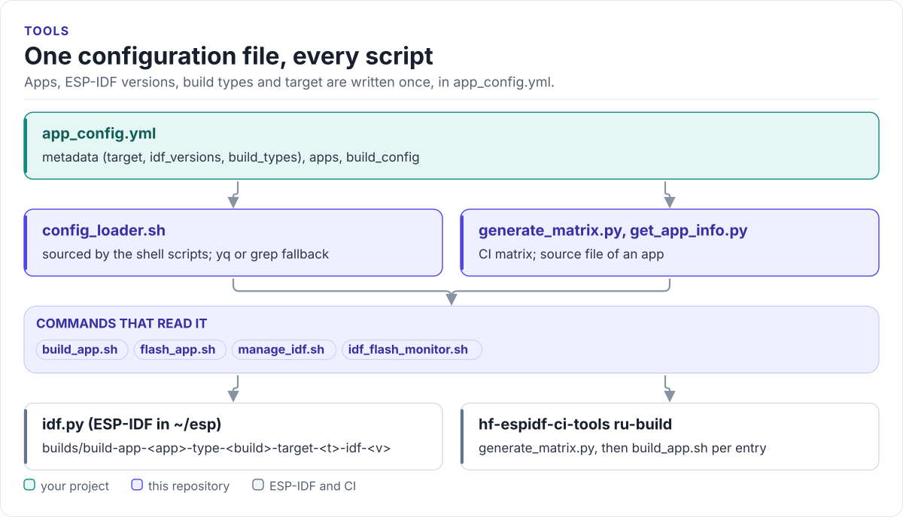

# Figures

<!-- Generated by hardfoc-docs figures from docs/diagrams/figures/*.py. Do not edit by hand. -->

Every figure on this site is drawn by a Python module from facts extracted from the code, so it is rebuilt,
not redrawn, when the code changes. CI runs `hardfoc-docs figures --check` and fails when a
committed figure no longer matches the code. Each figure below lists the files it is drawn from.

## One configuration file, every script

<!-- figure: tool-map -->
<picture>
  <source media="(prefers-color-scheme: dark)" srcset="tool-map.dark.svg">
  
</picture>
<!-- /figure -->

Figure module: [`docs/diagrams/figures/tool-map.py`](../../docs/diagrams/figures/tool-map.py)

Drawn from:

- `source config_loader.sh` in [`build_app.sh`](../../build_app.sh)
- `source config_loader.sh` in [`flash_app.sh`](../../flash_app.sh)
- `source config_loader.sh` in [`manage_idf.sh`](../../manage_idf.sh)
- `source config_loader.sh` in [`idf_flash_monitor.sh`](../../idf_flash_monitor.sh)
